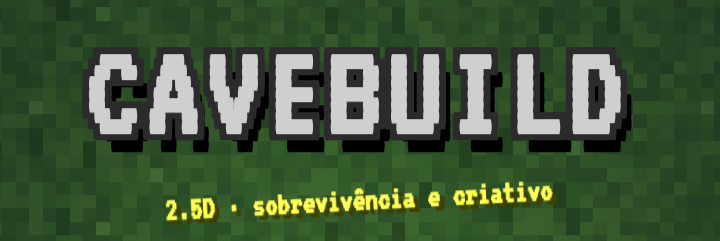

  

<h1 align="center">CaveBuild</h1>

  Jogo de sobrevivência e criativo em 2.5D, visto de cima, com cavernas, vilas e construção. 
  Roda no navegador, sem instalação.

  <a href="https://lucasrfmiele13-afk.github.io/CaveBuild/"><b>▶ Jogar agora</b></a>
  &nbsp;•&nbsp;
  <a href="https://github.com/lucasrfmiele13-afk/CaveBuild/raw/main/cavebuild.apk"><b>📱 Baixar para Android</b></a>

---

## ✨ Recursos

- 🎮 **Dois modos:** Sobrevivência e Criativo
- 🗺️ **Três tamanhos de mundo:** Pequeno, Médio e Grande
- 🏘️ **Vilas** com casas de tamanhos diferentes, baús com loot, fornalhas, tapetes, cercados com animais, plantações e aldeões
- ⛏️ **Cavernas** com vários minérios e monstros
- 💾 **Salvamento automático** dos mundos no próprio navegador
- 💬 **Chat** para conversar durante o jogo

## 🎮 Controles

### Celular e tablet

- Botões na tela para andar
- Botão de ação para atacar, quebrar blocos e interagir
- Botão de inventário e receitas no canto da tela

### Computador (teclado)

| Tecla | Ação |
|:-----:|------|
| <kbd>W</kbd> <kbd>A</kbd> <kbd>S</kbd> <kbd>D</kbd> ou <kbd>↑</kbd> <kbd>←</kbd> <kbd>↓</kbd> <kbd>→</kbd> | Andar |
| <kbd>J</kbd> | Quebrar blocos |
| <kbd>K</kbd> | Colocar blocos |
| <kbd>E</kbd> | Abrir inventário |
| <kbd>T</kbd> | Abrir chat |

## 🚀 Como jogar

1. Acesse o [jogo no navegador](https://lucasrfmiele13-afk.github.io/CaveBuild/) ou baixe o [APK para Android](https://github.com/lucasrfmiele13-afk/CaveBuild/raw/main/cavebuild.apk).
2. Escolha um modo (Sobrevivência ou Criativo) e um tamanho de mundo.
3. Explore, colete recursos, construa sua base e interaja com os aldeões.
4. Seu progresso fica salvo no navegador.

## 🖥️ Plataformas

| Plataforma | Como jogar |
|------------|-----------|
| 💻 Computador | Abra o [jogo no navegador](https://lucasrfmiele13-afk.github.io/CaveBuild/) |
| 🌐 Celular (navegador) | Abra o [jogo no navegador](https://lucasrfmiele13-afk.github.io/CaveBuild/) |
| 🤖 Android | Baixe o [cavebuild.apk](https://github.com/lucasrfmiele13-afk/CaveBuild/raw/main/cavebuild.apk) |

## 🛠️ Tecnologia

HTML, CSS e JavaScript puro, sem dependências externas. Todo o jogo está em um único arquivo.

## 🗺️ Roadmap

- [x] Modos Sobrevivência e Criativo
- [x] Vilas, cavernas e chat
- [ ] Mais tipos de monstros
- [ ] Novos biomas
- [ ] Multiplayer completo

## 📄 Licença

Projeto pessoal. Entre em contato antes de reutilizar o código.

---

Feito com ❤️ por <a href="https://github.com/lucasrfmiele13-afk">Lucas</a>

