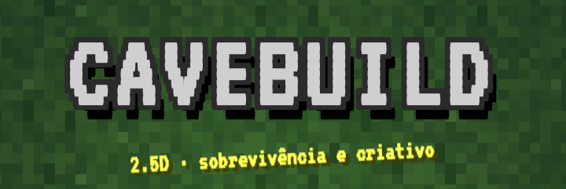

 [Jogar Cavebuild](https://lucasrfmiele13-afk.github.io/CaveBuild/)
    
# Cavebuild

Jogo de sobrevivência e criativo em 2.5D, visto de cima, feito em um único arquivo HTML.

## Como jogar

Abra o `index.html` no navegador (ou acesse pelo GitHub Pages).

- **Modos:** Sobrevivência e Criativo.
- **Tamanhos de mundo:** Pequeno, Médio e Grande.
- **Vilas:** cada mundo pode ter vilas com casas (de tamanhos diferentes), baús com loot, fornalhas, tapetes, cercados com animais, plantações e aldeões.
- **Cavernas:** há cavernas com vários minérios e monstros.
- **Mundos** são salvos no próprio navegador.

## Controles

- Botões na tela para andar.
- Botão de ação para atacar, quebrar blocos e interagir.
- Botão de inventário e receitas no canto da tela.

## Teclado

- WASD ou setas para andar
- E para abrir o inventário
- J para quebrar blocos
- K para colocar blocos
- T para abrir o chat

## Android

Para jogar no celular, baixe o `cavebuild.apk` ou abra o `index.html` no navegador.

## Tecnologia

HTML, CSS e JavaScript puro, sem dependências externas.
